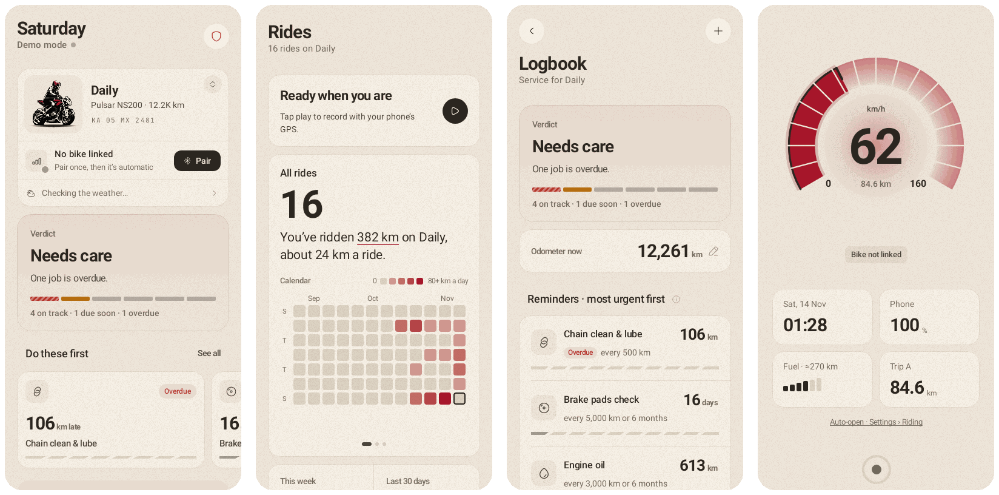

<div align="center">

# Waylink

**Your bike's display, connected.**

A free companion app for Bajaj Pulsar and Dominar motorcycles with the Bluetooth digital cluster.<br>
Turn arrows and caller names on your cluster, and your bike's care in one place.

**[Get the Android preview](https://github.com/krishnaar21/Waylink/releases/tag/android-preview)** · **[Open the web app](https://krishnaar21.github.io/Waylink/)**

No account · No ads · No tracking · Your data stays on your phone

<br>



</div>

---

## What Waylink does

Bajaj's Bluetooth cluster can show navigation arrows and who's calling, but the official app does little else. Waylink links to the same cluster and adds everything a rider keeps track of: how far you've ridden, what the bike needs next, what you spend on fuel, and who to call if something goes wrong.

It's built for:

- **Daily commuters** who want the next turn on the cluster instead of glancing at a phone.
- **Touring riders** who log long rides and want fuel range and mileage they can trust.
- **Riders who look after their own bike** and want service reminders by km or by date, not a paper booklet.
- **Anyone riding alone**, with an SOS card that holds local emergency numbers, an emergency contact and a Medical ID.

## Core features

| | |
|---|---|
| **Today** | Your bike at a glance: link status, a service verdict (on track, due soon, overdue), the jobs to do first, weather for the ride, missed calls and where you parked. |
| **Bike link** | Pairs with the cluster over Bluetooth once, then reconnects on its own. Sends turn arrows, caller names and the time. |
| **Rides** | Records rides with your phone's GPS. A riding calendar, km per week and km by weekday, plus trip meters. |
| **Ride mode** | A big speedometer screen for the handlebar mount, with time, phone battery, fuel range and trip. |
| **Route** | Rehearse a route or send a test turn to see how arrows look on your cluster. |
| **Logbook** | Every service, with reminders for chain, oil, brakes and more, by km or months, whichever comes first. |
| **Fuel log** | Fill-ups, range left, and mileage worked out properly: full tank to full tank. |
| **Glovebox** | Licence, insurance and PUC with expiry reminders. |
| **SOS** | One tap to call an ambulance, police, highway help or your emergency contact, with your blood group and allergies on screen. Numbers are set by your country (13 supported, including India, Brazil, Mexico, Turkey and the UK/EU). |
| **Garage** | More than one bike, each with its own odometer, specs, logbook and fuel history. |

**Supported bikes:** Pulsar NS200, RS200, NS400Z, NS160, NS125, N250 / F250, N160 / N150, 150 / 125, 220F, and Dominar 400 and 250, when fitted with the Bluetooth cluster (the one that can show calls). No bike handy? Every screen also works with a simulated bike.

## Private by design

Everything you enter stays on your phone. There's no account and no server holding your data. The only things that leave the phone are your rough location, sent to [Open-Meteo](https://open-meteo.com) for weather and [OpenStreetMap](https://nominatim.openstreetmap.org) for place names. Use *Settings → Backup & restore* to move to a new phone; the backup file works in both the Android and web apps.

---

## Download

### Android (preview)

1. On your Android phone, open the **[android-preview release](https://github.com/krishnaar21/Waylink/releases/tag/android-preview)**.
2. Under *Assets*, tap **waylink-debug.apk** to download it.
3. Open the downloaded file. If Android asks, allow your browser to *install unknown apps*, then tap **Install**.
4. Open Waylink, and on Today tap **Pair** with the bike's ignition on.

Needs Android 8.0 or newer. The preview is rebuilt automatically after every change, so installing it again later updates the app in place and keeps your data.

> **It's an early preview.** It's a test build signed with a development key, not a Play Store release, so Play Protect may warn you before installing. Bluetooth pairing is new and hasn't been tested on every cluster yet. Live turns from Google Maps and call alerts on the cluster are still being built.

### Web app

Open **[krishnaar21.github.io/Waylink](https://krishnaar21.github.io/Waylink/)** and add it to your Home Screen: *Install app* in Chrome on Android, or *Share → Add to Home Screen* on iPhone. It works offline once installed.

- **Android:** Chrome pairs with the cluster directly.
- **iPhone:** Safari can't use Bluetooth from a web page, so Waylink walks you through opening it in the free Bluefy browser, which can.

### iPhone app

A native iPhone app is planned. Until then, use the web app above.

---

## For developers

| Folder | What it is | Status |
|---|---|---|
| [`android/`](android/) | Native Android app (Kotlin, Jetpack Compose), ported faithfully from the web app's design. | In progress, preview builds on every push |
| [`web-v0/`](web-v0/) | The original web app and the design reference for the native apps. Tagged `v0`. | Live on GitHub Pages |
| `web/` | Dashboard and analytics, synced from the phone apps. | Planned |
| `ios/` | Native iPhone app. | Planned |

**Android:** needs JDK 17 and the Android SDK (Android Studio has both).

```
cd android
./gradlew :core:test           # shared data and maths, checked against the web app's numbers
./gradlew :app:assembleDebug   # app/build/outputs/apk/debug/app-debug.apk
```

**Web:** plain HTML, CSS and ES modules, no build step. See [`web-v0/README.md`](web-v0/README.md).

```
cd web-v0 && python3 -m http.server 8765   # then open http://localhost:8765
```

---

## Credits

Bluetooth protocol from [PulsarNav](https://github.com/nikhilmaity00/pulsarnav) · icons by [Hugeicons](https://hugeicons.com) · weather by [Open-Meteo](https://open-meteo.com) · places by [OpenStreetMap Nominatim](https://nominatim.openstreetmap.org).

Not affiliated with Bajaj Auto, OTC, Google or WhatsApp. Names and marks belong to their owners.
